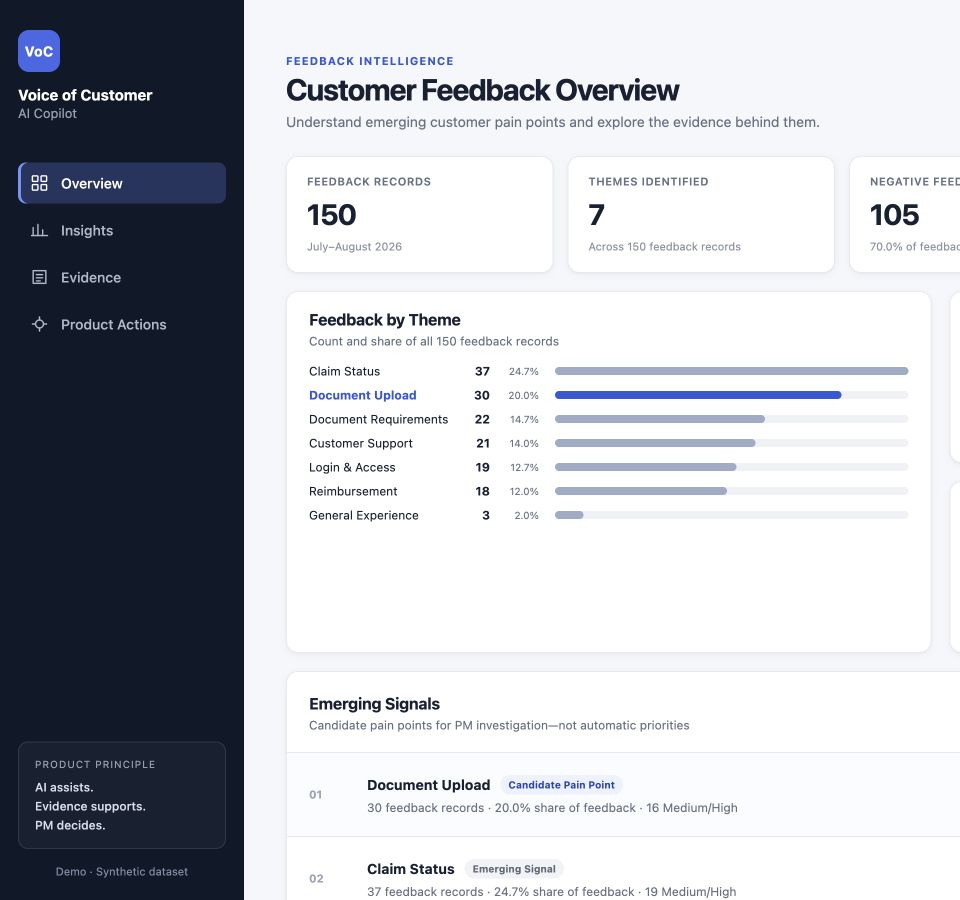
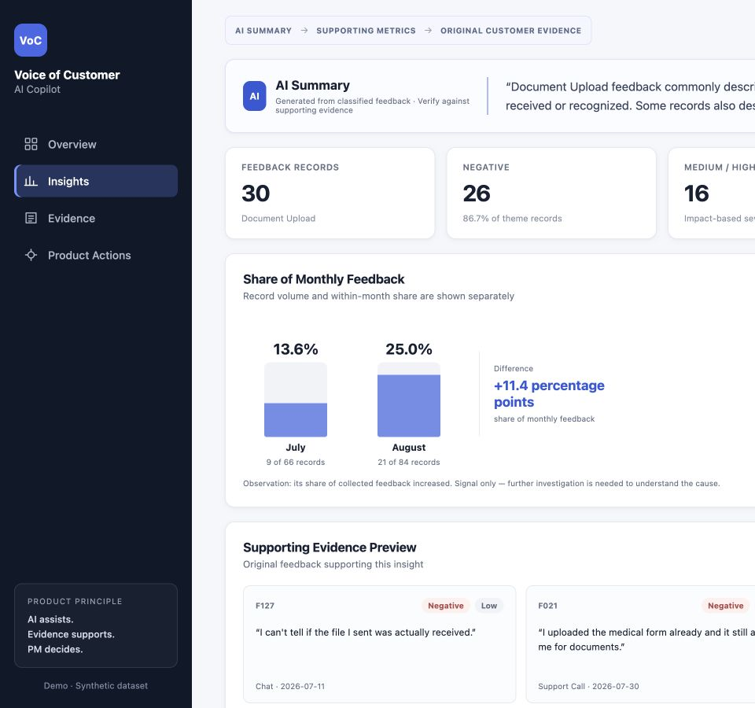
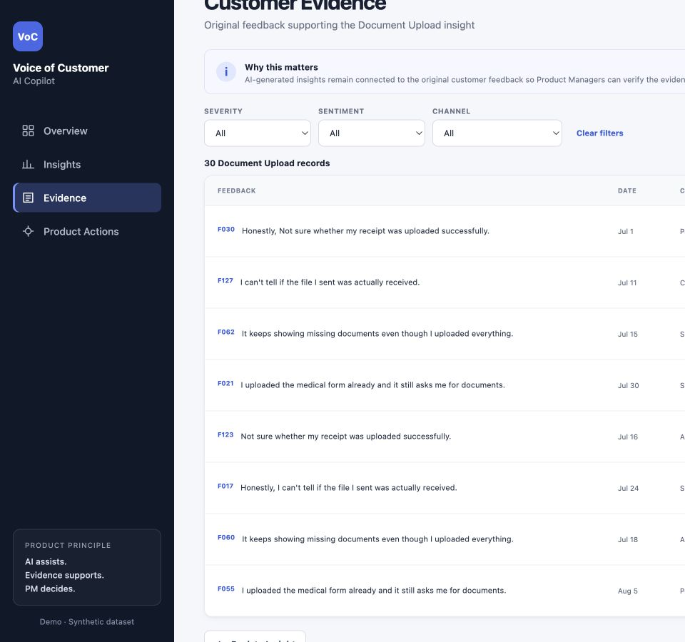
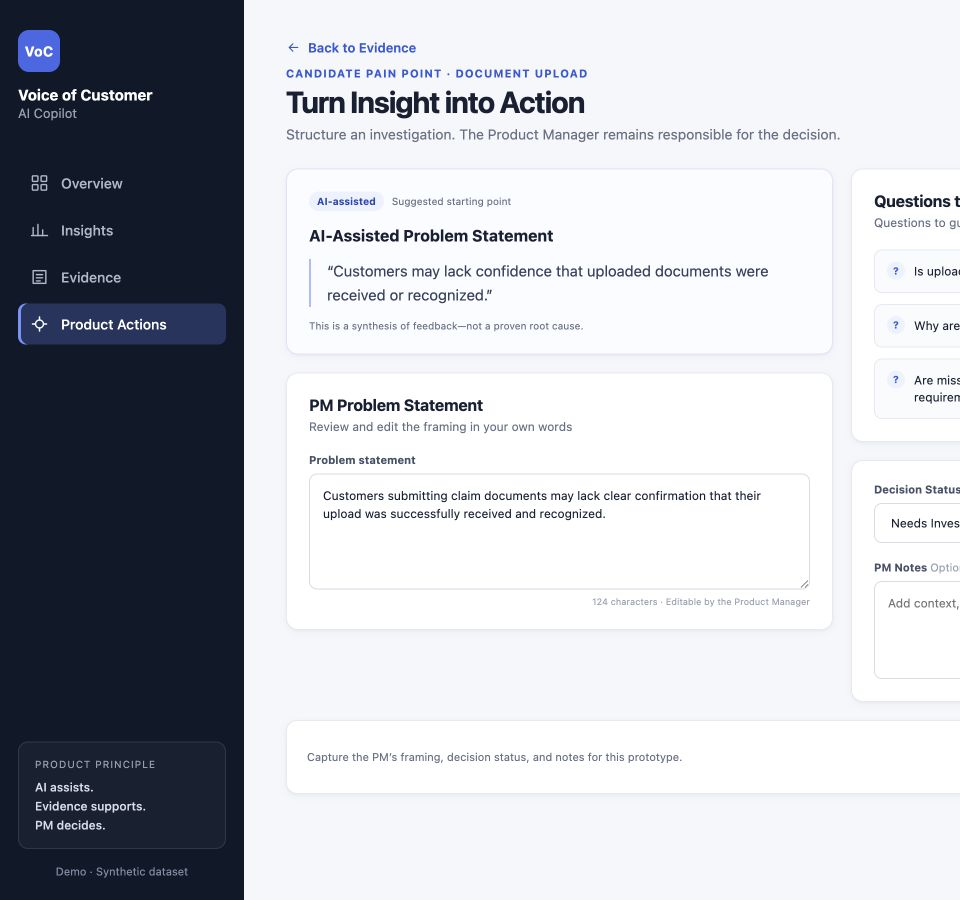

# Voice of Customer AI Copilot

An AI-assisted Product Management case study that turns synthetic, unstructured customer feedback into structured signals, traceable evidence, and candidate areas for Product Manager investigation.

> **AI assists. Evidence supports. PM decides.**



📄 **Case study deck:** [PDF](demo/Voice_of_Customer_AI_Copilot_Portfolio_Case_Study_Final_v4.pdf) · [PPTX](demo/Voice_of_Customer_AI_Copilot_Portfolio_Case_Study_Final_v4.pptx)

---

## Table of contents

- [Product overview](#product-overview)
- [Problem, user, and job to be done](#problem-user-and-job-to-be-done)
- [The web prototype](#the-web-prototype)
- [AI's role and the four-dimension taxonomy](#ais-role-and-the-four-dimension-taxonomy)
- [Evaluation approach](#evaluation-approach)
- [Results](#results)
- [Product decision: what the AI is allowed to do](#product-decision-what-the-ai-is-allowed-to-do)
- [Repository structure](#repository-structure)
- [Running the project](#running-the-project)
- [Limitations](#limitations)

---

## Product overview

Product Managers often receive feedback as free text. It can be difficult to identify recurring friction, assess what the feedback actually supports, and verify an AI-generated summary against the original customer evidence.

This project follows the product flow:

```text
Raw customer feedback → AI classification → Structured product signals → Candidate pain point → Customer evidence → PM investigation
```

The core principle: **AI assists with evidence organization. The Product Manager owns the decision.**

## Problem, user, and job to be done

| | |
|---|---|
| **Primary user** | Product Manager |
| **Problem** | A PM needs to make sense of a large volume of unstructured feedback without losing the evidence behind a pattern. |
| **Job to be done** | Identify recurring customer friction, inspect supporting feedback, and decide what deserves deeper investigation. |

Faster synthesis, earlier visibility into recurring friction, and evidence-backed investigation are **hypotheses** to validate with real PM workflows and production data. They are not measured outcomes in this synthetic case study.

---

## The web prototype

`web-prototype/` is a local, desktop-first React + Vite prototype that walks a PM from a high-level overview to an insight, its original evidence, and a structured product action. It reads a local copy of the classified synthetic CSV in the browser. **There is no backend and no live AI API call.**

### 1. Overview: where is customer friction showing up?


The overview summarizes all 150 synthetic feedback records (July–August 2026) by theme and highlights **Emerging Signals**, which are candidate pain points for PM investigation rather than automatic priorities. In this dataset, *Document Upload* stands out as a candidate pain point: 30 records, 20.0% of all feedback, and 16 rated Medium/High.

### 2. Insights: what does the AI summary say, and what supports it?



Each insight follows a visible chain: **AI Summary → Supporting Metrics → Original Customer Evidence**. The AI summary is labeled *"Verify against supporting evidence."* Supporting metrics show the theme's volume, negative share, and impact-based severity. They also compare its share of monthly feedback: 13.6% in July and 25.0% in August, a change of +11.4 percentage points. The screen presents this as an observation only: further investigation is needed to understand the cause.

### 3. Evidence: read the original feedback



AI-generated insights stay connected to the original customer feedback, so a PM can verify the evidence instead of trusting a summary. Records can be filtered by severity, sentiment, and channel.

### 4. Product Actions: turn the insight into an investigation



The AI proposes a problem statement as a *suggested starting point*, explicitly *"a synthesis of feedback, not a proven root cause."* The PM rewrites the framing in their own words, works through guiding investigation questions, sets a decision status (for example, *Needs Investigation*), and adds notes.

> **Prototype scope note:** the prototype reflects an earlier **seven-theme** classifier (`data/processed/customer_feedback_classified.csv`). It does not implement the later V2 taxonomy or the Feedback Type dimension used in the evaluation.

---

## AI's role and the four-dimension taxonomy

The evaluation taxonomy (`evaluation/taxonomy/evaluation_taxonomy_v2.md`) classifies each record on four **independent** dimensions:

| Dimension | Question it answers | Labels |
|---|---|---|
| **Theme** | What product or journey area is the feedback about? | Document Requirements, Document Upload, Claim Submission & Form, Claim Status, Reimbursement, Login & Account, Customer Support, General Experience |
| **Feedback Type** | What kind of feedback is being expressed? | Process Friction, Technical Issue, Improvement Request, Information Need, Compliment, General Feedback |
| **Sentiment** | What attitude or evaluation is expressed? | Positive, Neutral, Negative |
| **Severity** | What impact is *explicitly* described? | No Issue, Low, Medium, High |

Key taxonomy principles:

- *General Experience* is a fallback theme, used only when no more specific theme applies.
- Negative or emotional wording alone must **not** raise Severity. Severity reflects only the impact the customer explicitly describes.
- An Information Need does not automatically imply adverse impact.

Classification uses the **Gemini Developer API** (`gemini-3.5-flash-lite`) with schema-constrained structured JSON output and strict local validation. The model receives only `feedback_id`, `feedback_text`, `channel`, and `journey_stage`. Classification is not treated as an autonomous product decision.

---

## Evaluation approach

```text
Dataset V2 (150 synthetic records)
 ├── Development set: 40 human-reviewed records ──► Prompt experiments V1 / V2 / V3
 │                                                   └─► Baseline V1 selected & frozen (hash-locked)
 └── Holdout set: 24 human-reviewed records, locked BEFORE candidate selection
                                                     └─► One final, unseen evaluation of frozen V1
```

Experiment integrity safeguards:

- **Hash locks:** the approved holdout, frozen V1 instructions, and V1 development artifacts are verified by SHA-256 before a run (`evaluation/holdout/evaluation_holdout_lock.md`, `evaluation/development/evaluation_final_candidate_lock.md`).
- **Allowlisted inputs:** the model never sees human labels.
- **Prediction-first saving:** predictions are validated and saved *before* they are compared with human labels.
- **Locked labels:** human reference labels are never changed to match model output.
- **No post-holdout optimization:** holdout results must not be used to tune V1 and then be re-run as though still unseen.

### Prompt experiments (development set, 40 records)

| Version | Theme | Feedback Type | Sentiment | Severity | All-fields exact match |
|---|---|---|---|---|---|
| **Baseline V1** ✅ | 97.5% | 85.0% | 82.5% | 92.5% | **67.5%** |
| Prompt V2 | 95.0% | 90.0% | 52.5% | 82.5% | 37.5% |
| Prompt V3 | 95.0% | 87.5% | 85.0% | 85.0% | 62.5% |

Prompt V2 improved Feedback Type but pushed many clearly negative records to Neutral, so Sentiment fell to 52.5%. Prompt V3 recovered most of that drop but regressed on Severity and Theme. **Baseline V1** had the best overall exact match and was selected before the holdout run. These are development-set numbers used during iteration, so they are not unbiased estimates. Full details are in [`evaluation/development/evaluation_prompt_v1_v2_v3_comparison.md`](evaluation/development/evaluation_prompt_v1_v2_v3_comparison.md).

---

## Results

### Final holdout (24 unseen records, frozen Baseline V1)

| Dimension | Correct | Accuracy |
|---|---|---|
| Theme | 24 / 24 | **100.0%** |
| Feedback Type | 20 / 24 | **83.3%** |
| Sentiment | 21 / 24 | **87.5%** |
| Severity | 14 / 24 | **58.3%** |
| All-fields exact match | 11 / 24 | **45.8%** |

Exact match was 10/18 (55.6%) on records the human reviewers marked *Clear* and 1/6 (16.7%) on records marked *Ambiguous*.

### The central failure mode: Severity overprediction

| Human \ Gemini | No Issue | Low | Medium | High |
|---|---|---|---|---|
| **No Issue** | 3 | **7** | 0 | 0 |
| **Low** | 1 | 3 | **2** | 0 |
| **Medium** | 0 | 0 | 6 | 0 |
| **High** | 0 | 0 | 0 | 2 |

**7 of 10** records that humans labeled *No Issue* were predicted as *Low*, and 2 *Low* records were predicted as *Medium*. The model tends to infer impact the customer never stated. Other observed errors were *Process Friction* vs *Technical Issue* confusion (2 records) and *Neutral* classified as *Negative* (2 records).

Full matrices and per-class metrics: [`evaluation/holdout/evaluation_final_holdout_report.md`](evaluation/holdout/evaluation_final_holdout_report.md). Individual mismatches: [`evaluation/holdout/evaluation_final_holdout_errors.csv`](evaluation/holdout/evaluation_final_holdout_errors.csv).

> These figures come from a small synthetic dataset. They are **not** production performance claims and do not establish customer, business, or revenue impact.

---

## Product decision: what the AI is allowed to do

The main lesson: **evaluation changed what the AI should be allowed to do.** Different outputs earned different levels of trust:

| Output | Holdout evidence | Product permission |
|---|---|---|
| Theme | 100.0% | Can organize and group feedback |
| Feedback Type / Sentiment | 83–88% | Useful signals, verified against the evidence |
| Severity | 58.3%, systematic overprediction | **Review signal only.** Must not drive prioritization without PM review |

AI summaries always stay linked to the original records, and the PM makes the decision.

---

## Repository structure

```text
.
├── README.md
├── requirements.txt                  # Python deps: pandas, google-genai
├── data/
│   ├── raw/                          # Original 150-record synthetic feedback
│   ├── processed/                    # Earlier seven-theme classifier output (used by prototype)
│   └── v2/                           # Synthetic Dataset V2 (source of dev + holdout sets)
├── src/
│   ├── exploratory/                  # Initial pandas exploration
│   ├── initial-classifier/           # Earlier 150-record Gemini classifier
│   └── validation/                   # Deterministic Dataset V2 validation
├── evaluation/
│   ├── taxonomy/                     # Approved V2 taxonomy (canonical definitions)
│   ├── development/                  # 40-record dev set, V1/V2/V3 evaluators, frozen results, candidate lock
│   └── holdout/                      # 24-record locked holdout, final evaluator, predictions, errors, report
├── web-prototype/                    # React/Vite PM prototype + synthetic CSV copy
├── docs/
│   ├── images/                       # Prototype screenshots used in this README
│   ├── presentation_content_source.md
│   ├── portfolio_claim_evidence_register.md
│   ├── portfolio_project_defense_guide.md
│   ├── portfolio_file_map.md         # Slide-by-slide evidence map
│   └── file_inventory.md             # Inclusion / exclusion decisions
└── demo/                             # Final case-study deck (PPTX + PDF)
```

For a slide-by-slide evidence map, see [`docs/portfolio_file_map.md`](docs/portfolio_file_map.md). For inclusion decisions and excluded artifacts, see [`docs/file_inventory.md`](docs/file_inventory.md).

---

## Running the project

### Web prototype

Requires Node.js and pnpm (npm also works).

```bash
cd web-prototype
pnpm install
pnpm dev        # or: npm install && npm run dev
```

Open the local URL Vite prints, normally <http://localhost:5173>.

### Python scripts

```bash
python -m venv .venv
source .venv/bin/activate
pip install -r requirements.txt
export GEMINI_API_KEY="your-key"   # read via os.getenv; never commit it
```

The scripts are kept **unchanged** as frozen evidence. They were written to run from a single flat project folder: each script resolves its inputs and outputs relative to its own location, and the evaluators import `evaluate_gemini_baseline` as a sibling module. To re-run one, copy it into a working folder alongside the data files it references.

The evaluators also verify SHA-256 hashes of their frozen inputs before calling the API. Do **not** re-run the final holdout to tune the baseline. Any future prompt or model change needs a new, untouched test set.

---

## Limitations

- All datasets are **synthetic**. No real customer or production data was used.
- The final holdout has only 24 records, chosen to cover the taxonomy rather than to reflect real-world prevalence.
- Human reference labels involve judgment, including records marked Ambiguous.
- No user research, production deployment, privacy review, business-impact measurement, or real customer-data pilot was performed.
- The locked holdout must not be reused to refine the selected baseline.
- The prototype reflects the earlier seven-theme classifier, not the V2 evaluation taxonomy.
